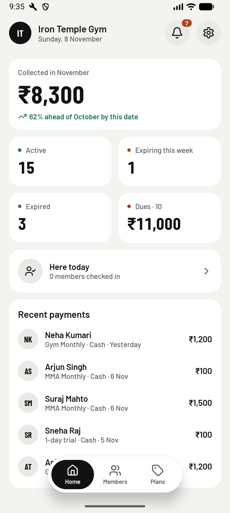
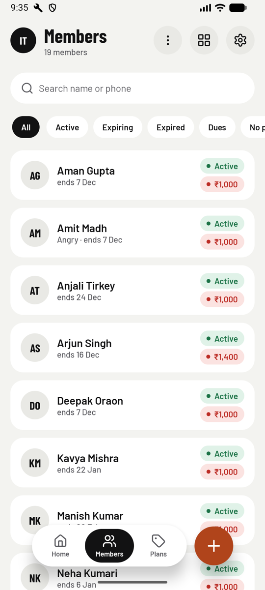
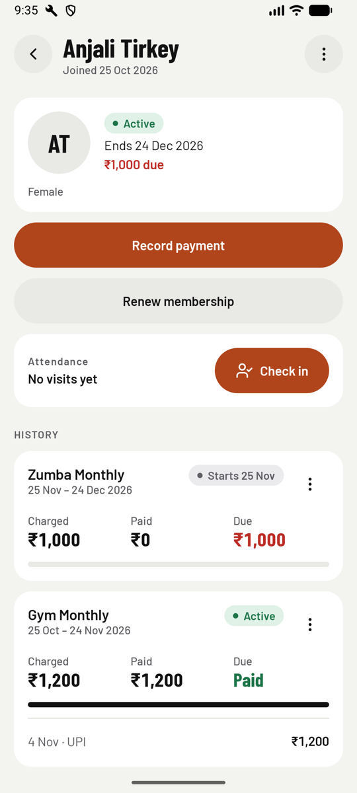
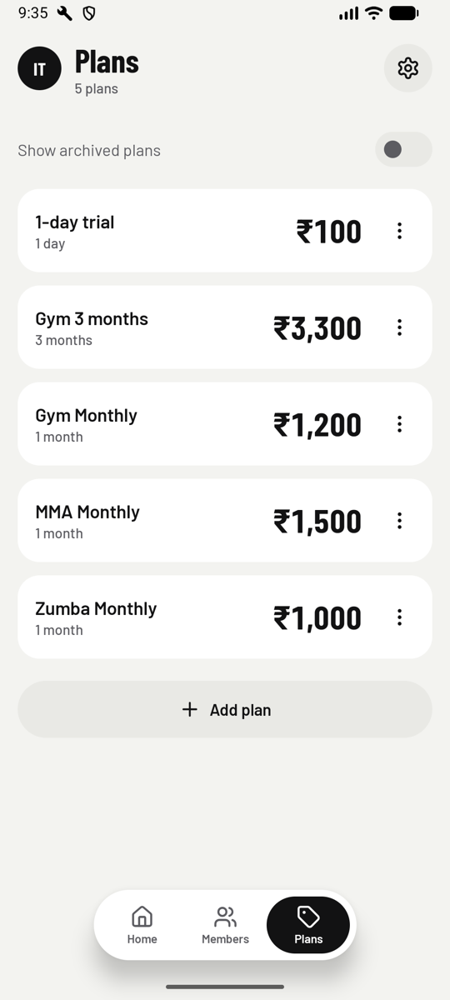
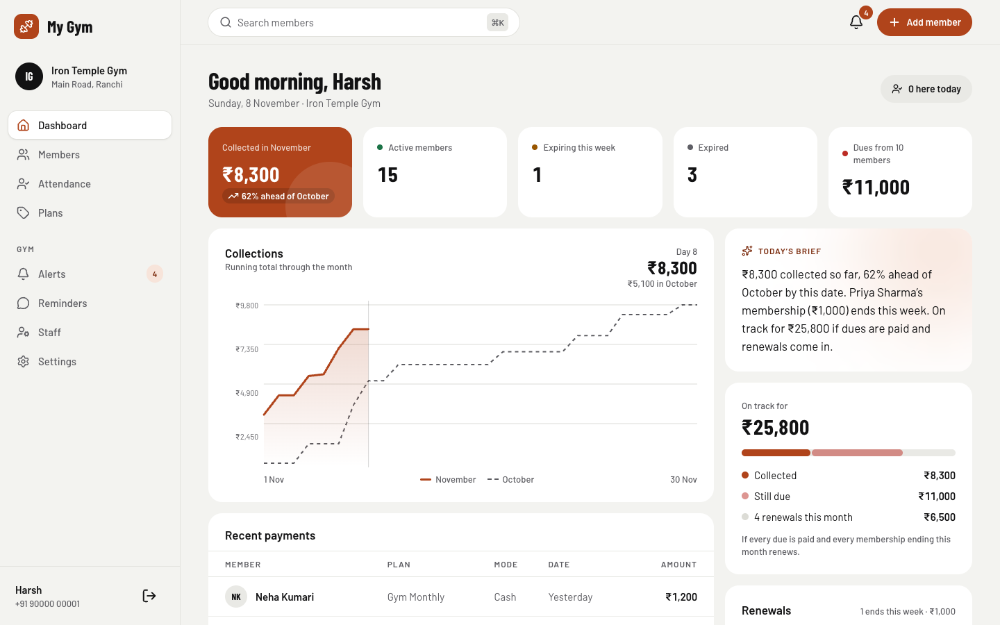
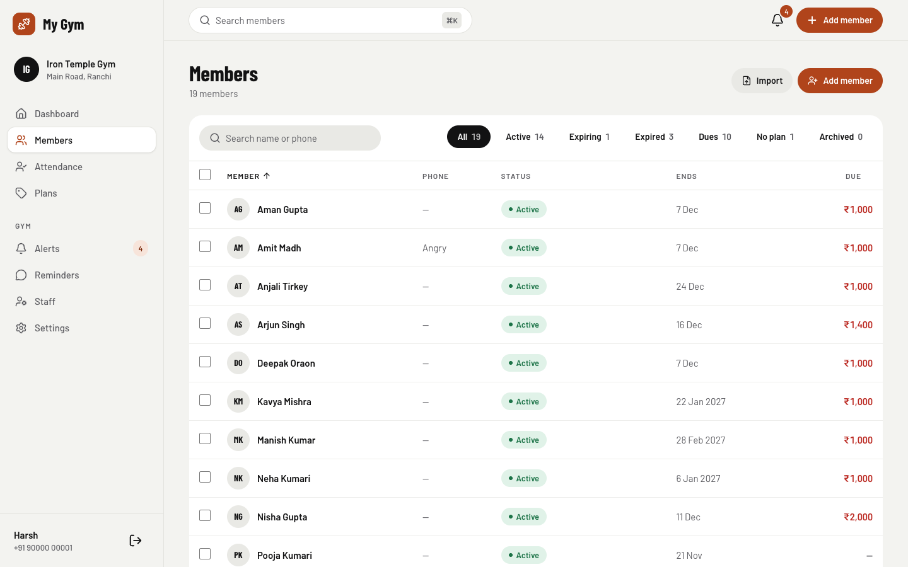
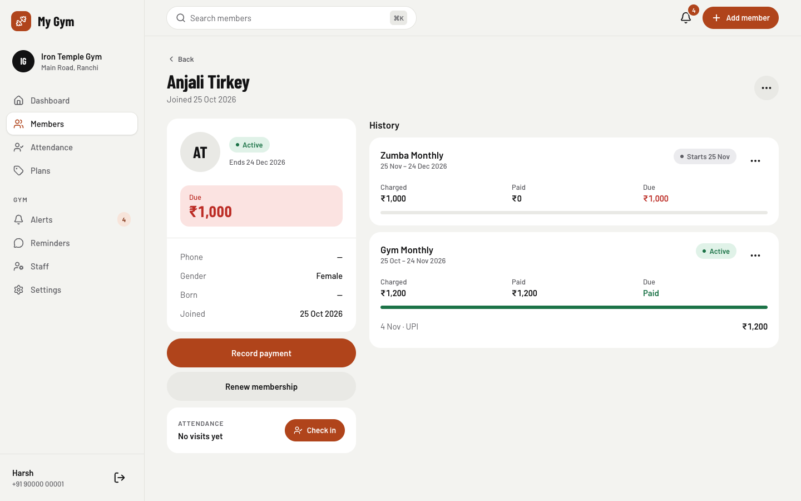

<p align="center">
  
</p>

<h1 align="center">My Gym</h1>

**My Gym runs a gym's front desk from a phone.** Owners and their staff keep members, plans and payments in one
place, see at a glance who has expired or still owes money, check members in as they arrive, and send WhatsApp
reminders and receipts without retyping anything. It runs on Android, iOS and the web, all working from the same
gym online.

<p align="center">
  
  
  
  
</p>

## What it does

### See what needs attention
Home opens on this month's collections and how they compare with last month by the same date. Below that are
counts of active, expiring and expired members, the total still owed, who's in today and the latest payments.

### Members
Each member has a profile with a photo, contact details, notes and their full history of memberships and
payments. You can search by name or phone, filter by status (active, expiring, expired, owing, no plan) and
switch between a list and a grid. A whole member list can be brought in from a CSV file.

### Plans, memberships and payments
Set up what the gym sells (a monthly plan, three months, a one-day trial) and sell or renew a membership in a few
taps. Payments can be recorded in part, so you always know what's still due. Long-press members to renew,
archive or delete several at once.

### Attendance
Staff check members in from the "Here today" screen or from a member's page, once per member a day. Each member's
page shows a 12-week heatmap of the days they came. Members with a running plan who haven't come in for two weeks
appear under **Gone quiet**, with a "we miss you" message ready to send.

### WhatsApp
Welcome messages, payment receipts, renewal reminders and "we miss you" messages are written for you, in English
or Hindi. You can send them yourself through WhatsApp, or connect the gym's WhatsApp Business number (through
WhatsApp's Cloud API or a Make.com scenario) so they go out automatically. The app lists the message templates
WhatsApp needs to approve. See [docs/whatsapp-make-setup.md](docs/whatsapp-make-setup.md).

### A team, not just an owner
The owner invites staff with a code shared over WhatsApp. Staff do the daily work: members, renewals, payments
and check-ins. What the gym takes in, the forecast and deleting records stay with the owner.

### And also
- **A morning update:** whose membership ends today, dues, and this month's collection
- **An alerts inbox** for expiries, payments and other things worth knowing
- **Insights:** a short brief on how the month is going, a forecast, and who to chase first
- **Siri and Android App Functions:** ask for the gym's summary, check a member, list who's expiring or owing,
  or record a payment
- **Hindi and English**, with light and dark themes
- **Demo mode** with a sample gym, for trying the app or showing it to someone

### On the web
The same gym in a browser, laid out for a desk screen with a sidebar and tables, and still usable on a phone.
See [web/README.md](web/README.md) for what the web doesn't do and how to run it.

<p align="center">
  
</p>
<p align="center">
  
  
</p>

## How it's built

- **Kotlin Multiplatform** shares the business rules across Android and iOS, and **Compose Multiplatform** shares
  the UI. On iOS 26 the tab bar and floating buttons are native Liquid Glass.
- **Supabase** is the backend: Postgres with row-level security keeping each gym's data to itself, Auth (phone
  code and Google), Realtime so every device sees changes as they happen, and Storage for photos and logos.
- **Room** holds demo mode's sample gym on the device.
- **React, Vite and Tailwind** for the web client, against the same Supabase project.

## Developer guide

### Repository layout

| Folder | What's in it |
| --- | --- |
| `androidApp/` | Android entry point, App Functions and platform setup |
| `iosApp/` | Xcode project, Siri intents, Sign in with Apple and the on-device model |
| `sharedLogic/` | Domain models and rules, use cases, view models, and the Supabase and Room data layers |
| `sharedUI/` | Compose screens, components, navigation, theme and strings (English and Hindi) |
| `gym-templates/` | The gym's WhatsApp message templates: names, wording and variables |
| `whatsapp-cloud/` | A standalone client for the WhatsApp Business Cloud API |
| `supabase/` | Database migrations, row-level security, seed data and SQL tests |
| `web/` | The web client |
| `docs/` | Setup guides and screenshots |

### Prerequisites

- Android Studio with Kotlin Multiplatform support, and Xcode on macOS for iOS
- A JDK matching the Gradle setup (the Gradle wrapper is included, so use `./gradlew`)
- The [Supabase CLI](https://supabase.com/docs/guides/cli) and Docker, to run the backend locally
- Node.js, for the web client

### Choose a backend

With nothing configured, the apps talk to local Supabase. Start it, and apply the migrations and seed data,
with:

```bash
supabase start
supabase db reset
```

To use a hosted project instead, add it to `local.properties`:

```properties
supabase.url=https://<project-ref>.supabase.co
supabase.publishableKey=<publishable key>
```

Google sign-in appears once `google.webClientId` and `google.iosClientId` are set there too.

To apply new migrations to the linked hosted project, run `supabase db push --remote`. Without `--remote`, the
CLI pushes to local.

The hosted database is backed up every night by a GitHub Actions workflow, encrypted, and kept for 30 days;
see [docs/backups.md](docs/backups.md) for setting it up and restoring.

### Build and run

```bash
./gradlew :androidApp:installDebug   # build and install on a connected device or emulator
```

For iOS, open `iosApp` in Xcode, pick a simulator or device, and run. For the web, see
[web/README.md](web/README.md).

### Tests

```bash
./gradlew :sharedUI:testAndroidHostTest :sharedLogic:testAndroidHostTest   # shared logic and UI, on the JVM
./gradlew :sharedLogic:iosSimulatorArm64Test                               # the same on the iOS simulator
supabase test db                                                           # database rules and security
cd web && npm test                                                         # the web's rules
```

## Status

My Gym is in active development against a staging backend. Production waits for launch.
